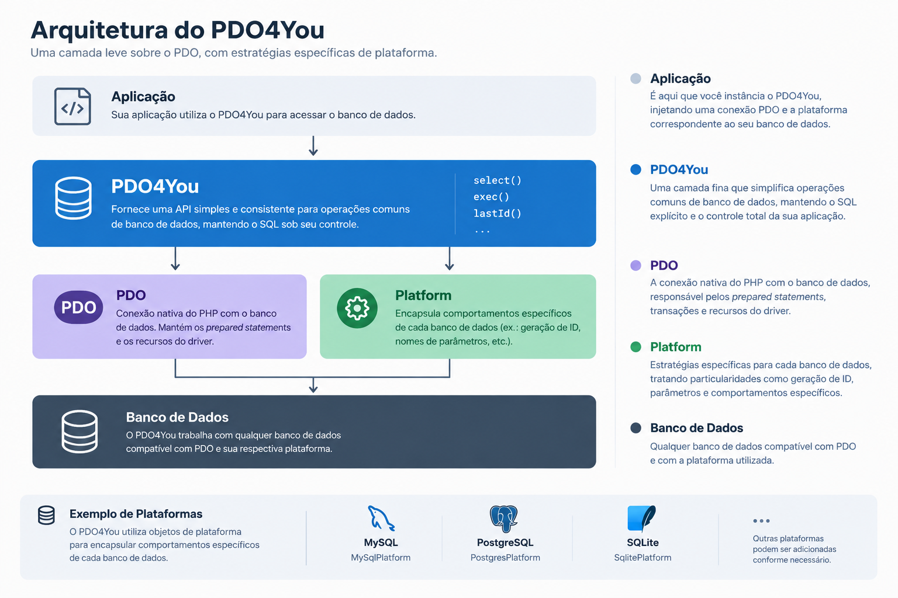

# PDO4You

[](https://www.php.net/)
[](https://github.com/giovanniramos/PDO4You/releases)
[](LICENSE)

*[Read documentation in English](README.md)*

**Um wrapper de banco de dados moderno, leve e testável para PHP.**

O **PDO4You** simplifica o uso do PDO sem adicionar o overhead e a complexidade de um ORM completo.

Construído para **PHP 8.2+**, o PDO4You mantém o SQL sob seu controle enquanto adiciona uma camada de abstração segura para operações comuns de banco de dados, injeção de dependência e estratégias específicas de plataforma.

> **PDO4You não substitui o PDO. Ele trabalha junto com ele.**

---

## ✨ Características

* 🚀 **Leve e Zero Dependências** — uma camada fina sobre o PDO sem nenhuma dependência externa de execução.
* 🧩 **Simples** — continue escrevendo SQL nativo mantendo controle total sobre as consultas.
* 💉 **Testável** — suporte completo a injeção de dependência (`PDO` e `DatabasePlatform`).
* ⚡ **Inicialização Rápida** — fábrica `connect()` e detecção automática da plataforma a partir do DSN ou da instância `PDO`.
* 📦 **PSR-4 e Pronto para Uso Standalone** — funciona via Composer ou diretamente sem Composer através do `autoload.php` integrado.
* 🐘 **PHP Moderno** — tipagem estrita, `#[\SensitiveParameter]`, `readonly` e recursos do PHP 8.2+.
* 🔌 **Estratégias por Plataforma** — abstração de dialetos (escape de identificadores, savepoints e captura de último ID) para **MySQL/MariaDB**, **PostgreSQL**, **SQLite** e **SQL Server**.
* 🛡️ **Segurança e Tipagem Nativa** — *prepared statements* reais com detecção automática de tipos escalares (`PARAM_INT`, `PARAM_BOOL`, `PARAM_NULL`, `PARAM_LOB`).
* 🔄 **Transações e Savepoints** — controle transacional seguro via closures com *rollback* automático e suporte a transações aninhadas via `SAVEPOINT`.
* 🌊 **Streaming com `cursor()`** — iteração *lazy* de grandes volumes de dados usando `Generator` com consumo de memória $O(1)$.
* 📊 **Observabilidade** — listeners por instância (seguro para Swoole/Octane/RoadRunner) e global para logging e profiling.
* 🚫 **Sem ORM** — sem entidades complexas ou mapeamentos obrigatórios.

---

## 📦 Instalação

### Opção 1: Via Composer (Recomendada)

Se você utiliza o [Composer](https://getcomposer.org/) para gerenciar as dependências do seu projeto, instale o PDO4You com:

```bash
composer require giovanniramos/pdo4you
```

> 💡 **Dicas para usuários do Composer:**
> * **Ainda não tem o Composer instalado?** Consulte o [Guia Oficial de Instalação do Composer](https://getcomposer.org/doc/00-intro.md) (ou baixe em [getcomposer.org/download](https://getcomposer.org/download/)), ou utilize diretamente a **Opção 2** abaixo.
> * **Erro de extensão `zip` ausente?** O Composer requer que a extensão `zip` do PHP (`extension=zip` no seu `php.ini`) ou um utilitário `unzip`/`7z` esteja ativo para extrair pacotes (especialmente em instalações novas do PHP no Windows/Laragon/XAMPP).

### Opção 2: Standalone (Sem Composer)

Como o PDO4You **não possui dependências externas de execução**, você pode baixar o [arquivo ZIP](https://github.com/giovanniramos/PDO4You/archive/refs/heads/master.zip) ou clonar o repositório e incluir diretamente o arquivo `autoload.php` nativo (PSR-4), sem precisar do Composer:

```bash
git clone https://github.com/giovanniramos/PDO4You.git
```

```php
<?php

require_once __DIR__ . '/caminho/para/PDO4You/autoload.php';

use PDO4You\PDO4You;

$db = PDO4You::connect('sqlite::memory:');
```

---

## ⚡ Início Rápido

Você pode inicializar o PDO4You de duas formas: através da fábrica `connect()` via DSN ou injetando uma conexão `PDO` existente.

### 1. Inicialização via DSN (Recomendada)

O método estático `connect()` configura opções seguras por padrão e infere a plataforma correta pelo driver do DSN (`mysql`, `pgsql`, `sqlite` ou `sqlsrv`):

```php
<?php

use PDO4You\PDO4You;

$db = PDO4You::connect(
    'mysql:host=localhost;dbname=mydb;charset=utf8mb4',
    'usuario',
    'senha'
);
```

### 2. Injeção de Dependência (`PDO`)

Ideal para contêineres de DI (Injeção de Dependências) ou para reaproveitar conexões existentes. A plataforma é detectada automaticamente a partir do driver do `PDO` (ou pode ser injetada explicitamente):

```php
<?php

use PDO;
use PDO4You\PDO4You;
use PDO4You\Platform\MySqlPlatform;

$pdo = new PDO('mysql:host=localhost;dbname=mydb', 'usuario', 'senha');

// Detecção automática da plataforma a partir do PDO:
$db = new PDO4You($pdo);

// Ou injetando uma estratégia de plataforma customizada explicitamente:
$db = new PDO4You($pdo, new MySqlPlatform());
```

---

## 🧑‍💻 Uso

### Consultas (`SELECT`)

O PDO4You oferece métodos específicos para cada necessidade de leitura:

#### `select()` — Array associativo ou hidratação de DTOs
```php
// Retorna um array de arrays associativos
$users = $db->select(
    'SELECT * FROM users WHERE status = ?',
    ['active']
);

// Hidratação direta para instâncias de uma classe/DTO (PDO::FETCH_CLASS)
$users = $db->select(
    'SELECT id, name, email FROM users WHERE status = ?',
    ['active'],
    UserDto::class
);
```

#### `cursor()` — Streaming *Lazy* com `Generator` (Memória $O(1)$)
Ideal para processar grandes lotes de registros ou exportações sem carregar todo o resultado na memória RAM:

```php
foreach ($db->cursor('SELECT id, name FROM users WHERE active = ?', [true], UserDto::class) as $user) {
    echo $user->name . PHP_EOL;
}
```

#### `selectOne()` — Buscar uma única linha
Retorna apenas o primeiro registro (ou `null`) e fecha o cursor imediatamente:

```php
$user = $db->selectOne('SELECT * FROM users WHERE id = ?', [1]);

if ($user !== null) {
    echo $user['name'];
}
```

#### `selectVal()` — Valor escalar
Retorna diretamente o valor de uma única coluna da primeira linha (útil para contagens, somas e verificações):

```php
$total = (int) $db->selectVal('SELECT COUNT(*) FROM users WHERE status = ?', ['active']);
```

#### `selectObj()` — Array de objetos (`stdClass` ou classe específica)
```php
$users = $db->selectObj('SELECT name, email FROM users');

foreach ($users as $user) {
    echo $user->name;
}
```

#### `selectNum()` — Array indexado numericamente
```php
$rows = $db->selectNum('SELECT id, name FROM users');
// $rows[0][0] = id, $rows[0][1] = name
```

---

### Auxiliares DML Fluídos (`insert()`, `update()`, `delete()`)

Métodos dedicados para operações de escrita seguras com escape automático de identificadores (incluindo notação qualificada `schema.tabela`) e proteção contra cláusulas `WHERE` vazias:

#### `insert()` — Inserir um registro
```php
$affected = $db->insert('users', [
    'name'    => 'John',
    'surname' => 'Wick',
    'status'  => 'active',
]);

$lastId = $db->lastId();
```

#### `update()` — Atualizar registros
Suporta parâmetros nomeados ou posicionais na cláusula `WHERE`:

```php
$affected = $db->update(
    'users',
    ['status' => 'inactive'],
    'id = :id',
    ['id' => 5]
);
```

#### `delete()` — Deletar registros
```php
$affected = $db->delete(
    'users',
    'id = :id',
    ['id' => 10]
);
```

---

### Execução Direta e em Lote (`exec()`)

O método `exec()` executa instruções parametrizadas e retorna o total de linhas afetadas.

#### Execução Simples
```php
$affected = $db->exec(
    'UPDATE users SET status = ? WHERE id = ?',
    ['inactive', 5]
);
```

#### Execução em Lote (Batch Insert / Batch Update)
Ao passar uma lista de arrays, o PDO4You prepara a instrução uma única vez e executa cada conjunto de parâmetros de forma eficiente:

```php
$totalInserted = $db->exec(
    'INSERT INTO users (name, surname) VALUES (?, ?)',
    [
        ['John', 'Doe'],
        ['Jane', 'Doe'],
        ['Alice', 'Smith'],
    ]
);
```

---

### Paginação (`Pagination`)

A classe `Pagination` calcula automaticamente offsets, limites e metadados de navegação:

```php
use PDO4You\Pagination;

$total = (int) $db->selectVal('SELECT COUNT(*) FROM items');
$pagination = new Pagination(currentPage: 2, perPage: 10, total: $total);

$items = $db->select(
    'SELECT id, title FROM items ORDER BY id ASC LIMIT :limit OFFSET :offset',
    [
        'limit'  => $pagination->getLimit(),
        'offset' => $pagination->getOffset(),
    ]
);

$meta = $pagination->getMetadata();
// ['currentPage' => 2, 'perPage' => 10, 'total' => 25, 'totalPages' => 3, 'offset' => 10, 'hasPrevious' => true, 'hasNext' => true]
```

---

### Último ID Inserido (`lastId()`)

Obtém o identificador gerado na última inserção utilizando a estratégia nativa da plataforma ativa (incluindo captura automática no mesmo lote de escopo para `SCOPE_IDENTITY()` no SQL Server):

```php
$db->insert('users', ['name' => 'John']);

$userId = $db->lastId();

// Para PostgreSQL com sequences específicas:
// $userId = $db->lastId('users_id_seq');
```

---

### Transações Gerenciadas e Savepoints

O método `transaction()` encapsula operações em um bloco atômico seguro. Chamadas aninhadas utilizam savepoints nativos da plataforma automaticamente (`SAVEPOINT` / `SAVE TRANSACTION`):

```php
$db->transaction(function (PDO4You $conn) {
    $conn->exec('UPDATE accounts SET balance = balance - 100 WHERE id = ?', [1]);
    $conn->exec('UPDATE accounts SET balance = balance + 100 WHERE id = ?', [2]);

    // Transação aninhada (Savepoint)
    $conn->transaction(function (PDO4You $nested) {
        $nested->insert('audit_logs', ['action' => 'transfer']);
    });
});
```

Controles manuais (`beginTransaction()`, `commit()`, `rollBack()` e `inTransaction()`) também estão disponíveis.

---

### Observabilidade e Logs (`addQueryListener` / `onQuery`)

Monitore o tempo de execução (em milissegundos) e os parâmetros de cada consulta. Falhas dentro dos listeners são isoladas para nunca interromper a execução do banco:

```php
// Listener por instância (recomendado para Octane, Swoole, RoadRunner e múltiplos bancos)
$db->addQueryListener(function (string $sql, array $params, float $durationMs) {
    if ($durationMs > 50.0) {
        error_log(sprintf('[Slow Query: %.2fms] %s', $durationMs, $sql));
    }
});

// Ou listener global estático
PDO4You::onQuery(function (string $sql, array $params, float $durationMs) {
    // ...
});
```

---

### Tratamento de Erros (`QueryException`)

Todas as falhas de preparação ou execução do PDO são convertidas em `PDO4You\Exception\QueryException`, preservando o contexto completo do erro:

```php
use PDO4You\Exception\QueryException;

try {
    $db->insert('users', ['email' => 'duplicado@exemplo.com']);
} catch (QueryException $e) {
    echo $e->getMessage();    // Mensagem detalhada
    echo $e->getSqlState();   // Código ANSI SQLSTATE (ex: '23000', '23505')
    echo $e->getDriverCode(); // Código específico do driver (ex: 1062 no MySQL)
    echo $e->getSql();        // A instrução SQL que falhou
    print_r($e->getParams()); // Parâmetros vinculados à consulta
}
```

---

## 🔌 Plataformas Suportadas

O PDO4You utiliza implementações da interface `PDO4You\Platform\DatabasePlatform` para abstrair particularidades de cada banco de dados:

* `PDO4You\Platform\MySqlPlatform` — Suporte para **MySQL** e **MariaDB** (identificadores com `` ` ``, `SAVEPOINT` e `LAST_INSERT_ID()`).
* `PDO4You\Platform\PgSqlPlatform` — Suporte para **PostgreSQL** (identificadores com `"`, `SAVEPOINT`, `lastval()` e `currval()` validado).
* `PDO4You\Platform\SqlitePlatform` — Suporte para **SQLite** (identificadores com `"`, `SAVEPOINT` e `last_insert_rowid()`).
* `PDO4You\Platform\SqlSrvPlatform` — Suporte para **Microsoft SQL Server** (identificadores com `[ ]`, `SAVE TRANSACTION` e captura automática de `SCOPE_IDENTITY()` no mesmo lote).

---

## 🏗️ Arquitetura

O PDO4You adiciona uma camada fina sobre o PDO, mantendo o SQL explícito e encapsulando comportamentos específicos de cada banco através do padrão *Strategy* (`DatabasePlatform`).



---

## 🎯 Por que PDO4You?

O PDO já oferece uma excelente API nativa para acesso a bancos de dados, enquanto ORMs completos trazem camadas robustas de abstração. O **PDO4You** foi projetado exatamente para preencher o espaço entre eles: uma camada leve de conveniência sem abrir mão do controle do SQL.

- **Mais simples que um ORM** — sem entidades, modelos ou mapeamento obrigatório.
- **Mais conveniente que PDO puro** — métodos diretos de seleção, tratamento consistente de erros e execução em lote.
- **SQL continua no controle** — você escreve as consultas e decide como os dados são acessados.

---

## ⚡ Teste Rápido

Você pode testar imediatamente o funcionamento do PDO4You via linha de comando (mesmo sem ter o Composer instalado) executando o script incluído na raiz do projeto:

```bash
php quick-test.php
```

> 📌 **Nota:** O teste rápido e os exemplos interativos utilizam um banco SQLite em memória (`sqlite::memory:`) e requerem que a extensão **`pdo_sqlite`** esteja habilitada no seu `php.ini`.

---

## 🧪 Exemplos

O projeto inclui uma central interativa de exemplos práticos de utilização.

Para executar os exemplos no navegador (funciona imediatamente com ou sem Composer), inicie o servidor embutido do PHP:

```bash
php -S localhost:8000 -t examples
```

Depois, acesse no navegador:

```text
http://localhost:8000
```

Os exemplos principais utilizam SQLite em memória (`pdo_sqlite`) por padrão, permitindo experimentar a biblioteca sem a necessidade de configurar um servidor de banco de dados externo.

---

## 🛠️ Desenvolvimento e Testes Automatizados

Para executar a suíte de testes automatizados com PHPUnit, instale as dependências de desenvolvimento via Composer (requer `extension=zip` habilitada no `php.ini`):

```bash
git clone https://github.com/giovanniramos/PDO4You.git
cd PDO4You
composer install
```

Execute os testes localmente com PHPUnit:

```bash
./vendor/bin/phpunit tests
```

Ou execute as suítes completas de testes unitários e de integração (SQLite, MySQL e PostgreSQL) em um ambiente isolado com Docker:

```bash
docker compose build -q --no-cache
docker compose run --rm test
```

---

## 📋 Requisitos

* **PHP:** [8.2 ou superior](https://www.php.net/downloads)
* **Extensões PDO:** `ext-pdo` e o driver desejado (`pdo_mysql`, `pdo_pgsql`, `pdo_sqlite` ou `pdo_sqlsrv`)
* **Composer:** [getcomposer.org](https://getcomposer.org/download/) *(Opcional — recomendado para gerenciamento de pacotes e execução dos testes PHPUnit; requer `ext-zip` habilitada no `php.ini`)*

---

## 📄 Licença

PDO4You é distribuído sob a licença **MIT**. Consulte o arquivo [LICENSE](LICENSE) para mais detalhes.
