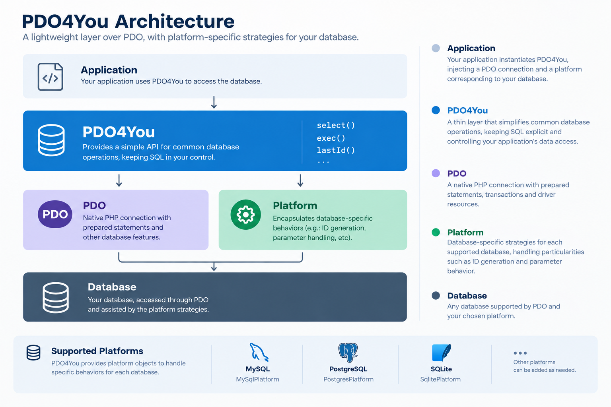

# PDO4You

[](https://www.php.net/)
[](https://github.com/giovanniramos/PDO4You/releases)
[](LICENSE)

*[Leia a documentação em Português-BR](README-pt-BR.md)*

**A modern, lightweight, and testable database wrapper for PHP.**

**PDO4You** simplifies PDO usage without adding the overhead and complexity of a full ORM.

Built for **PHP 8.2+**, PDO4You keeps SQL under your control while adding a clean, secure abstraction layer for common database operations, dependency injection, and platform-specific strategies.

> **PDO4You does not replace PDO. It works alongside it.**

---

## ✨ Features

* 🚀 **Lightweight & Zero Dependencies** — A thin layer over PDO with zero external runtime dependencies.
* 🧩 **Simple** — Keep writing native SQL while maintaining full control over your queries.
* 💉 **Testable** — First-class support for dependency injection (`PDO` and `DatabasePlatform`).
* ⚡ **Fast Setup** — `connect()` factory and automatic platform detection from DSN strings or existing `PDO` instances.
* 📦 **PSR-4 & Standalone Ready** — Works seamlessly with Composer or standalone via the built-in `autoload.php`.
* 🐘 **Modern PHP** — Strict typing, `#[\SensitiveParameter]`, `readonly` properties, and PHP 8.2+ features.
* 🔌 **Platform Strategies** — Dialect abstraction (identifier quoting, savepoints, and last insert ID retrieval) for **MySQL/MariaDB**, **PostgreSQL**, **SQLite**, and **SQL Server**.
* 🛡️ **Native Security & Typed Binding** — True prepared statements with automatic scalar type detection (`PARAM_INT`, `PARAM_BOOL`, `PARAM_NULL`, `PARAM_LOB`).
* 🔄 **Managed Transactions & Savepoints** — Safe transaction handling through closures with automatic rollback and nested transaction support via dialect-aware savepoints.
* 🌊 **Lazy Iteration with `cursor()`** — Yield rows one-by-one using PHP `Generator` without materializing the full result array in PHP userland memory.
* 📊 **Observability** — Instance-scoped listeners (safe for Swoole/Octane/RoadRunner) and global callbacks for query logging and profiling.
* 🚫 **No ORM** — No complex entities or mandatory mappings.

---

## 📦 Installation

### Option 1: Via Composer (Recommended)

If you use [Composer](https://getcomposer.org/) to manage your project dependencies, install PDO4You with:

```bash
composer require giovanniramos/pdo4you
```

> 💡 **Tips for Composer users:**
> * **Don't have Composer installed yet?** Follow the official [Composer Installation Guide](https://getcomposer.org/doc/00-intro.md) (or download it at [getcomposer.org/download](https://getcomposer.org/download/)), or simply use **Option 2** below.
> * **Missing `zip` extension error?** Composer requires PHP's `zip` extension (`extension=zip` enabled in your `php.ini`) or an `unzip`/`7z` utility to extract packages (especially on fresh Windows/Laragon/XAMPP PHP installations).

### Option 2: Standalone (Without Composer)

Because PDO4You has **zero external runtime dependencies**, you can download the [ZIP archive](https://github.com/giovanniramos/PDO4You/archive/refs/heads/master.zip) or clone the repository and require the built-in PSR-4 `autoload.php` file directly—no Composer required:

```bash
git clone https://github.com/giovanniramos/PDO4You.git
```

```php
<?php

require_once __DIR__ . '/path/to/PDO4You/autoload.php';

use PDO4You\PDO4You;

$db = PDO4You::connect('sqlite::memory:');
```

---

## ⚡ Quick Start

You can initialize PDO4You in two ways: using the `connect()` DSN factory or by injecting an existing `PDO` connection.

### 1. DSN Factory Initialization (Recommended)

The static `connect()` method sets secure defaults and automatically resolves the proper platform strategy from the DSN driver (`mysql`, `pgsql`, `sqlite`, or `sqlsrv`):

```php
<?php

use PDO4You\PDO4You;

$db = PDO4You::connect(
    'mysql:host=localhost;dbname=mydb;charset=utf8mb4',
    'username',
    'password'
);
```

### 2. Dependency Injection (`PDO`)

Ideal for Dependency Injection (DI) containers or when reusing existing database connections. The platform strategy is automatically detected from the `PDO` driver (or can be explicitly provided):

```php
<?php

use PDO;
use PDO4You\PDO4You;
use PDO4You\Platform\MySqlPlatform;

$pdo = new PDO('mysql:host=localhost;dbname=mydb', 'username', 'password');

// Automatic platform detection from the PDO driver:
$db = new PDO4You($pdo);

// Or explicitly injecting a platform strategy:
$db = new PDO4You($pdo, new MySqlPlatform());
```

---

## 🧑‍💻 Usage

### Queries (`SELECT`)

PDO4You provides dedicated methods for every read scenario:

#### `select()` — Associative arrays or DTO hydration
```php
// Returns an array of associative arrays
$users = $db->select(
    'SELECT * FROM users WHERE status = ?',
    ['active']
);

// Direct hydration into class/DTO instances (PDO::FETCH_CLASS)
$users = $db->select(
    'SELECT id, name, email FROM users WHERE status = ?',
    ['active'],
    UserDto::class
);
```

#### `cursor()` — Lazy Iteration with `Generator`
Ideal for iterating over large result sets row-by-row without building the full result array in PHP userland memory (underlying driver buffering follows your `PDO` connection configuration, such as `PDO::MYSQL_ATTR_USE_BUFFERED_QUERY`):

```php
foreach ($db->cursor('SELECT id, name FROM users WHERE active = ?', [true], UserDto::class) as $user) {
    echo $user->name . PHP_EOL;
}
```

#### `selectOne()` — Fetch a single row
Fetches only the first record (or `null`) and immediately closes the statement cursor:

```php
$user = $db->selectOne('SELECT * FROM users WHERE id = ?', [1]);

if ($user !== null) {
    echo $user['name'];
}
```

#### `selectVal()` — Scalar value
Directly returns a single column value from the first row (useful for counts, sums, and lookups):

```php
$total = (int) $db->selectVal('SELECT COUNT(*) FROM users WHERE status = ?', ['active']);
```

#### `selectObj()` — Array of objects (`stdClass` or custom class)
```php
$users = $db->selectObj('SELECT name, email FROM users');

foreach ($users as $user) {
    echo $user->name;
}
```

#### `selectNum()` — Numerically indexed arrays
```php
$rows = $db->selectNum('SELECT id, name FROM users');
// $rows[0][0] = id, $rows[0][1] = name
```

---

### Fluent DML Helpers (`insert()`, `update()`, `delete()`)

Dedicated methods for common write operations featuring automatic dialect-aware identifier quoting (including qualified `schema.table` names) and protection against empty `WHERE` clauses:

#### `insert()` — Insert a record
```php
$affected = $db->insert('users', [
    'name'    => 'John',
    'surname' => 'Wick',
    'status'  => 'active',
]);

$lastId = $db->lastId();
```

#### `update()` — Update records
Supports both named and positional parameters in the `WHERE` clause:

```php
$affected = $db->update(
    'users',
    ['status' => 'inactive'],
    'id = :id',
    ['id' => 5]
);
```

#### `delete()` — Delete records
```php
$affected = $db->delete(
    'users',
    'id = :id',
    ['id' => 10]
);
```

---

### Direct & Batch Execution (`exec()`)

The `exec()` method executes parameterized statements and returns the number of affected rows.

#### Single Execution
```php
$affected = $db->exec(
    'UPDATE users SET status = ? WHERE id = ?',
    ['inactive', 5]
);
```

#### Batch Execution (Batch Insert / Batch Update)
When passing a list of parameter arrays, PDO4You prepares the statement once and executes all parameter sets efficiently:

```php
$totalInserted = $db->exec(
    'INSERT INTO users (name, surname) VALUES (?, ?)',
    [
        ['John', 'Doe'],
        ['Jane', 'Doe'],
        ['Alice', 'Smith'],
    ]
);
```

---

### Pagination (`Pagination`)

The `Pagination` service calculates offsets, limits, and navigation metadata:

```php
use PDO4You\Pagination;

$total = (int) $db->selectVal('SELECT COUNT(*) FROM items');
$pagination = new Pagination(currentPage: 2, perPage: 10, total: $total);

$items = $db->select(
    'SELECT id, title FROM items ORDER BY id ASC LIMIT :limit OFFSET :offset',
    [
        'limit'  => $pagination->getLimit(),
        'offset' => $pagination->getOffset(),
    ]
);

$meta = $pagination->getMetadata();
// ['currentPage' => 2, 'perPage' => 10, 'total' => 25, 'totalPages' => 3, 'offset' => 10, 'hasPrevious' => true, 'hasNext' => true]
```

---

### Last Inserted ID (`lastId()`)

Retrieves the identifier generated by the last insert operation using the active platform strategy.

On **SQL Server (`sqlsrv`)**, `PDO4You` automatically captures `SCOPE_IDENTITY()` within the same execution batch (including CTE-led `WITH ... INSERT` statements and multi-statement `DECLARE`/`SET` batches), while transparently preserving caller result sets and affected-row counts for `INSERT ... OUTPUT` or `INSERT ...; SELECT/EXEC` batches even when `MultipleActiveResultSets` (MARS) is disabled:

```php
$db->insert('users', ['name' => 'John']);

$userId = $db->lastId();

// For PostgreSQL with specific sequences:
// $userId = $db->lastId('users_id_seq');
```

---

### Managed Transactions & Savepoints

The `transaction()` method wraps operations in a safe atomic block. Nested calls automatically use platform-specific SQL savepoints (`SAVEPOINT` / `RELEASE SAVEPOINT` / `ROLLBACK TO SAVEPOINT` on MySQL, PostgreSQL, and SQLite; `SAVE TRANSACTION` / `ROLLBACK TRANSACTION` on SQL Server):

```php
$db->transaction(function (PDO4You $conn) {
    $conn->exec('UPDATE accounts SET balance = balance - 100 WHERE id = ?', [1]);
    $conn->exec('UPDATE accounts SET balance = balance + 100 WHERE id = ?', [2]);

    // Nested transaction (Savepoint)
    $conn->transaction(function (PDO4You $nested) {
        $nested->insert('audit_logs', ['action' => 'transfer']);
    });
});
```

Manual transaction controls (`beginTransaction()`, `commit()`, `rollBack()`, and `inTransaction()`) are also available.

---

### Observability and Logging (`addQueryListener` / `onQuery`)

Monitor execution duration (in milliseconds) and parameters for every query. Listener exceptions are isolated so observability failures never disrupt database operations:

```php
// Instance-scoped listener (recommended for Octane, Swoole, RoadRunner, and multi-DB apps)
$db->addQueryListener(function (string $sql, array $params, float $durationMs) {
    if ($durationMs > 50.0) {
        error_log(sprintf('[Slow Query: %.2fms] %s', $durationMs, $sql));
    }
});

// Or global static listener
PDO4You::onQuery(function (string $sql, array $params, float $durationMs) {
    // ...
});
```

---

### Structured Error Handling (`QueryException`)

All PDO preparation and execution errors are wrapped in `PDO4You\Exception\QueryException`, preserving full diagnostic context:

```php
use PDO4You\Exception\QueryException;

try {
    $db->insert('users', ['email' => 'duplicate@example.com']);
} catch (QueryException $e) {
    echo $e->getMessage();    // Detailed error message
    echo $e->getSqlState();   // ANSI SQLSTATE code (e.g., '23000', '23505')
    echo $e->getDriverCode(); // Driver-specific error code (e.g., 1062 on MySQL)
    echo $e->getSql();        // The failed SQL query
    print_r($e->getParams()); // Bound parameters
}
```

---

## 🔌 Supported Platforms

PDO4You uses `PDO4You\Platform\DatabasePlatform` implementations to encapsulate engine-specific behavior:

* `PDO4You\Platform\MySqlPlatform` — Support for **MySQL** and **MariaDB** (`` ` `` identifier quoting, `SAVEPOINT`, and `LAST_INSERT_ID()`).
* `PDO4You\Platform\PgSqlPlatform` — Support for **PostgreSQL** (`"` identifier quoting, `SAVEPOINT`, `lastval()`, and validated `currval()`).
* `PDO4You\Platform\SqlitePlatform` — Support for **SQLite** (`"` identifier quoting, `SAVEPOINT`, and `last_insert_rowid()`).
* `PDO4You\Platform\SqlSrvPlatform` — Support for **Microsoft SQL Server** (`[ ]` identifier quoting, `SAVE TRANSACTION` / `ROLLBACK TRANSACTION`, and same-batch `SCOPE_IDENTITY()` capture with `OUTPUT` and multi-rowset buffering).

---

## 🏗️ Architecture

PDO4You adds a thin layer over PDO, keeping SQL explicit while encapsulating database-specific behavior through the *Strategy* pattern (`DatabasePlatform`).



---

## 🎯 Why PDO4You?

PDO already provides an excellent native API for database access, while full ORMs introduce robust abstraction layers. **PDO4You** was designed to fill the space between them: a lightweight convenience layer without giving up control over SQL.

- **Simpler than an ORM** — no entities, models, or mandatory mapping.
- **More convenient than raw PDO** — direct selection methods, consistent error handling, and batch execution.
- **SQL remains under your control** — you write the queries and decide how data is accessed.

---

## ⚡ Quick Test

You can immediately test PDO4You from the command line (even without Composer installed) using the script included in the project root:

```bash
php quick-test.php
```

> 📌 **Note:** The quick test and built-in examples use an in-memory SQLite database (`sqlite::memory:`) and require the **`pdo_sqlite`** PHP extension to be enabled in your `php.ini`.

---

## 🧪 Examples

The project includes an interactive suite of practical usage examples.

To run the examples in your browser (works out-of-the-box with or without Composer), start PHP's built-in web server:

```bash
php -S localhost:8000 -t examples
```

Then open the following URL in your browser:

```text
http://localhost:8000
```

The core examples use an in-memory SQLite database (`pdo_sqlite`) by default, allowing you to experiment with the library without configuring an external database server.

---

## 🛠️ Development & Running Tests

To run the automated PHPUnit test suite, install the development dependencies via Composer (requires `extension=zip` enabled in `php.ini`):

```bash
git clone https://github.com/giovanniramos/PDO4You.git
cd PDO4You
composer install
```

Run the tests locally with PHPUnit:

```bash
./vendor/bin/phpunit tests
```

Or run the full unit and integration test suites (SQLite, MySQL, and PostgreSQL) inside an isolated Docker environment:

```bash
docker compose build -q --no-cache
docker compose run --rm test
```

---

## 📋 Requirements

* **PHP:** [8.2 or higher](https://www.php.net/downloads)
* **PDO Extensions:** `ext-pdo` and the corresponding driver (`pdo_mysql`, `pdo_pgsql`, `pdo_sqlite`, or `pdo_sqlsrv`)
* **Composer:** [getcomposer.org](https://getcomposer.org/download/) *(Optional — recommended for package management and running PHPUnit tests; requires `ext-zip` enabled in `php.ini`)*

---

## 📄 License

PDO4You is distributed under the **MIT** license. See the [LICENSE](LICENSE) file for details.
